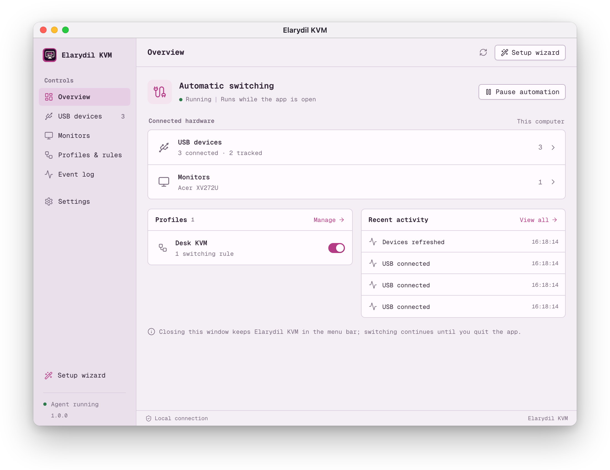
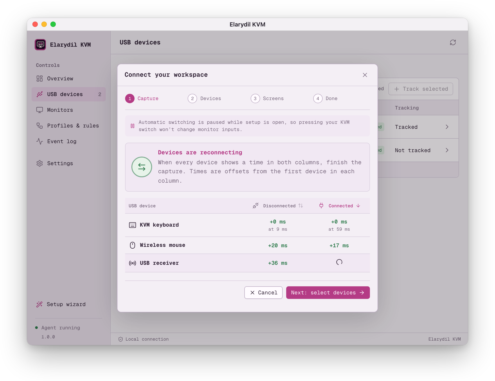
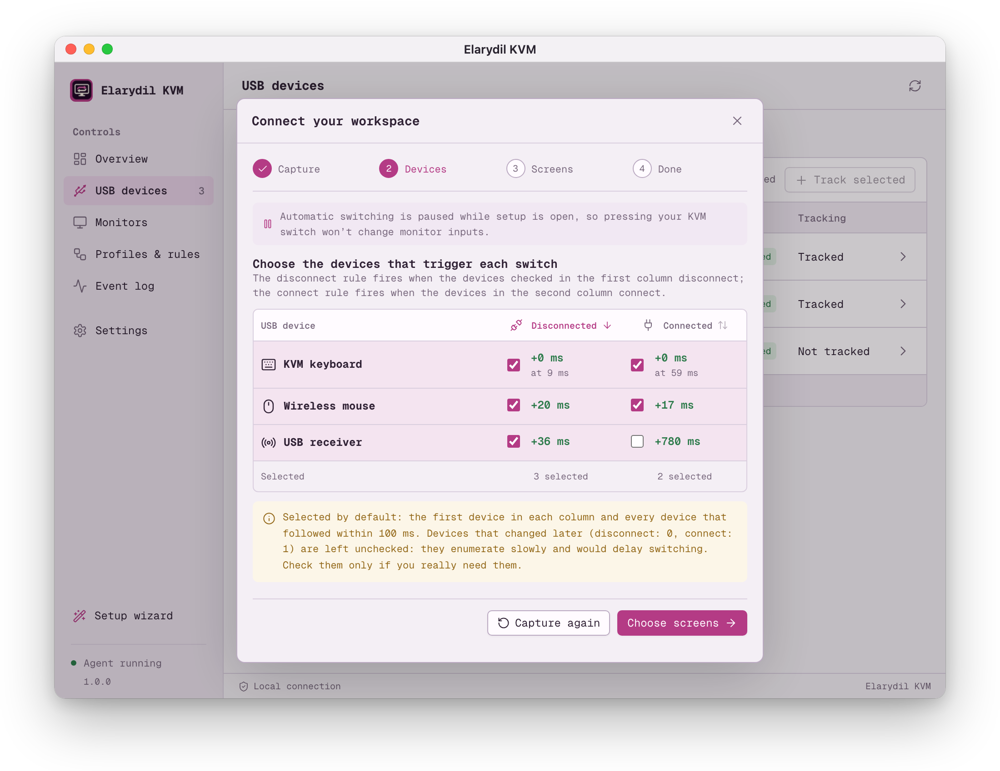
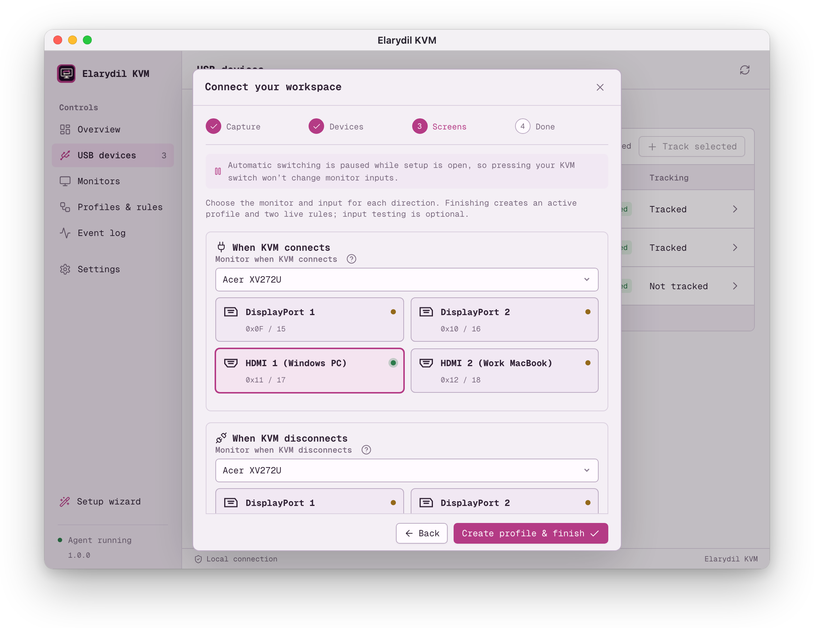
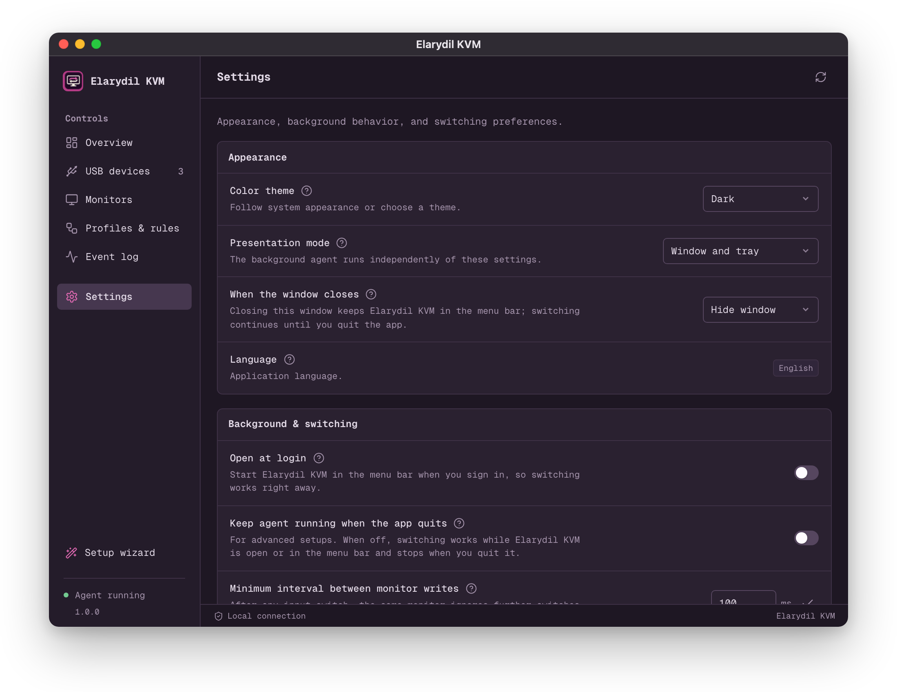
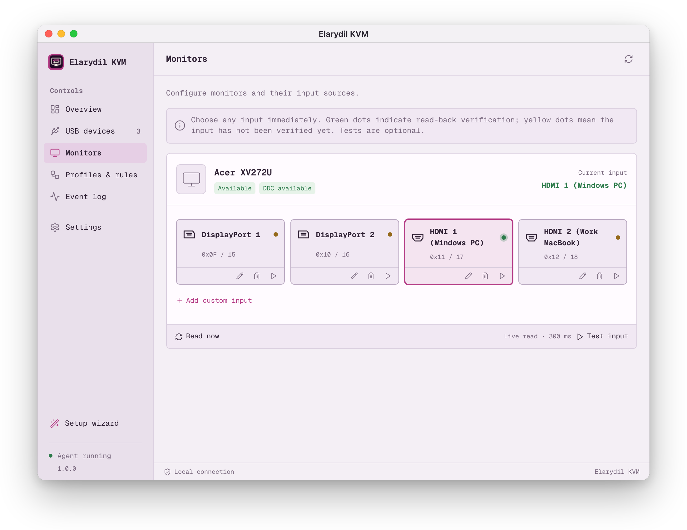
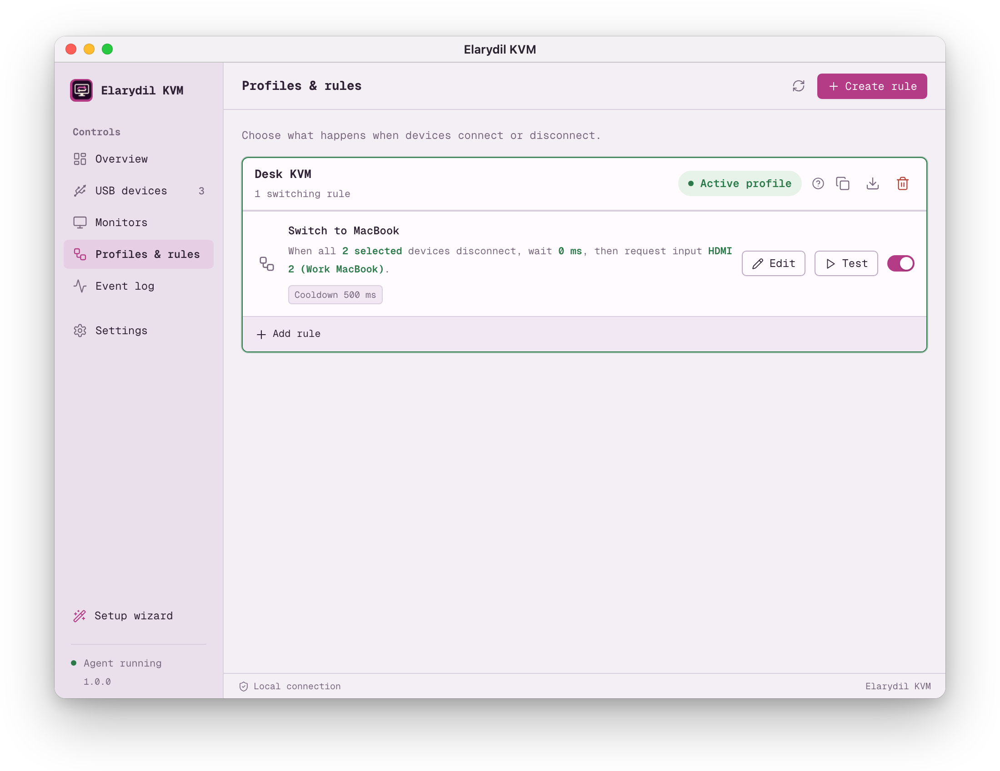
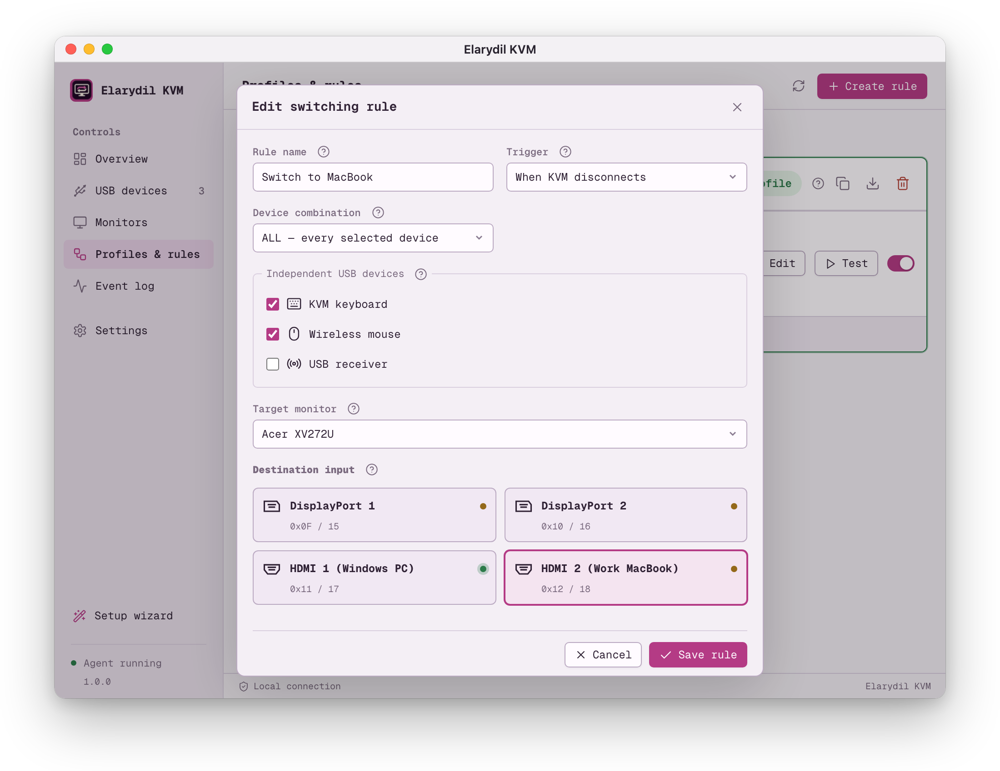

# Elarydil KVM

**Your USB KVM switch moves the keyboard and mouse. Elarydil KVM moves the monitor with them.**

When your USB devices leave this computer, Elarydil KVM tells the monitor to switch
to the other computer's input over DDC/CI, through the video cable you already have.
When they come back, it switches back. Everything runs locally: no account, no
network listener, no telemetry and no keyboard hooks.

> **Version 1.0.0** for **macOS on Apple Silicon**, **Windows 11 x64** and **Linux x86_64**.
> [Download from Releases](https://github.com/elarydil/elarydil-kvm/releases) ·
> [What's new](docs/releases/1.0.0.md) · [Features and platform support](IMPLEMENTATION_STATUS.md)



## Contents

- [Install](#install)
- [Set up in a minute](#set-up-in-a-minute)
- [How it runs](#how-it-runs)
- [Monitors and rules](#monitors-and-rules)
- [Command line](#command-line)
- [Build from source](#build-from-source)
- [Documentation](#documentation)

## Install

| Platform | Download | Notes |
|---|---|---|
| macOS 13+ on Apple Silicon | `Elarydil-KVM-1.0.0-macos-arm64.dmg` | Drag to Applications, then see [macOS first launch](docs/MACOS_FIRST_LAUNCH.md). |
| Windows 11 x64 | `Elarydil-KVM-1.0.0-windows-x64-setup.exe` | Windows may ask to confirm an unknown publisher. |
| Debian, Ubuntu | `Elarydil-KVM-1.0.0-linux-amd64.deb` | `sudo apt install ./Elarydil-KVM-*.deb` |
| Fedora | `Elarydil-KVM-1.0.0-linux-x86_64.rpm` | `sudo dnf install ./Elarydil-KVM-*.rpm` |
| CLI only (any platform) | `elarydil-kvm-cli-*.zip` | Agent and command line without the desktop app. |

Verify downloads with the release's `SHA256SUMS.txt`. Installed binaries need no
Rust, Node or Python runtime. Intel Macs are not supported. On Linux, DDC needs
access to `/dev/i2c-*`; see [Troubleshooting](docs/TROUBLESHOOTING.md).

## Set up in a minute

Open **Setup wizard** (the wand in the sidebar) and follow four steps. Automatic
switching is paused while the wizard is open, so pressing the KVM switch during
setup never changes your monitor.

**1. Capture.** Press the switch on your KVM, then press it again to come back.
Each device appears the moment it disconnects or reconnects. Times are shown as
offsets from the first device in each column, and the table sorts itself by the
phase you are in.



**2. Devices.** Choose which devices trigger the disconnect rule and which trigger
the connect rule. The first device in each column, and every device that followed
within 100 ms, is preselected. Slower devices usually enumerate late and would
only delay switching.



**3. Screens.** Pick the monitor and input for each direction. The current input
is marked with a green dot; your own names appear in brackets, such as
`HDMI 2 (Work MacBook)`.



**4. Done.** An active profile with two live rules is created and works
immediately. Prefer to do it by hand? Choose **Choose devices manually** in the
wizard, or **Create a rule manually** on the Profiles page.

## How it runs

Elarydil KVM has two parts: the **app** (window and menu-bar icon) and a small
**agent** process that watches USB devices and switches inputs.

- By default the agent **starts and stops with the app**. Closing the window keeps
  the app in the menu bar, and switching keeps working until you quit it.
- **Open at Login** in the menu-bar menu or in Settings starts the app when you sign in.
- For headless or always-on setups, turn on **Settings → Keep agent running when
  the app quits**. The agent then runs without the app and can start at login on
  its own. Its help explains how to stop it from Terminal:

  ```sh
  "/Applications/Elarydil KVM.app/Contents/Resources/bin/elarydil-kvm" agent stop
  ```



## Monitors and rules

**Monitors.** Every standard input (DisplayPort 1/2, HDMI 1/2) is selectable right
away. The current input is read live over DDC. Rename inputs, remove the ones you
don't use, or add a custom decimal/hex value. **Test input** switches for 15 seconds
and then returns automatically, with **Switch back now** for an early return.



**Profiles and rules.** Exactly one profile is active. Each rule says, in plain
words, which devices it watches and which input it requests. **Test** performs the
rule's switch for 15 seconds and then returns. Rule timing, dry run and custom shell
commands for connect/disconnect live in the rule's **Advanced** section.





DDC travels over the existing video cable. Enable DDC/CI in the monitor's on-screen
menu. A dock may carry video while blocking DDC. The built-in MacBook display is
excluded. If a monitor loses its DDC link, use its physical input button.

## Command line

Everything in the app is also available from `elarydil-kvm`. On macOS the CLI is
inside the app bundle at `Elarydil KVM.app/Contents/Resources/bin/`; the CLI-only
ZIP contains the same tools.

```sh
elarydil-kvm agent start
elarydil-kvm devices list --json
elarydil-kvm monitors list --json
elarydil-kvm wizard start            # interactive setup in the terminal
elarydil-kvm profiles list --json
elarydil-kvm status --json
```

Scripts can complete setup with separate trigger devices for each direction:

```sh
elarydil-kvm wizard complete \
  --disconnect-devices KEYBOARD_ID,MOUSE_ID --connect-devices KEYBOARD_ID \
  --connect-monitor MONITOR_ID --connect-input 17 \
  --disconnect-monitor MONITOR_ID --disconnect-input 18
```

See the [CLI guide](docs/CLI.md), [headless operation](docs/HEADLESS.md),
[custom commands](docs/COMMAND_HOOKS.md) and the generated
[reference for every command](docs/CLI_REFERENCE.md).

## Build from source

Requirements: Rust stable, Node 22+, and the Tauri prerequisites for your platform
(Xcode command-line tools on macOS; GTK 3, WebKitGTK 4.1 and AppIndicator development
packages on Linux).

```sh
cargo build --locked --release          # CLI, agent and helpers (no WebView)
cargo test --workspace --locked
python3 packages/build.py               # stage helpers for the desktop bundle
cd apps/desktop
npm ci
npm run tauri build -- --bundles dmg    # nsis on Windows, deb,rpm on Linux
```

UI tests drive the real interface against a virtual hardware backend:

```sh
cargo build --bins --example virtual_agent --locked
cd apps/desktop && npx playwright install chromium && npm test
```

The screenshots in this README are regenerated with
`ELARYDIL_SCREENSHOTS=1 npx playwright test -g "readme screenshots"`.

To release, run `python3 packages/bump-version.py <new version>`, write the generated
release notes and merge into `main`: GitHub Actions builds the Windows, macOS and
Linux installers and publishes the release. See [Building and releasing](docs/BUILDING.md).

## Documentation

- [Documentation index](docs/README.md)
- [macOS first launch](docs/MACOS_FIRST_LAUNCH.md) · [Troubleshooting](docs/TROUBLESHOOTING.md)
- [Architecture](docs/ARCHITECTURE.md) · [Configuration](docs/CONFIG_SCHEMA.md) ·
  [GUI/CLI equivalents](docs/GUI_CLI_PARITY.md)
- [Features and platform support](IMPLEMENTATION_STATUS.md) · [Uninstall](packages/uninstall.md)

## License

Elarydil KVM is released under the [MIT License](LICENSE). It includes
[m1ddc](vendor/m1ddc) by waydabber (MIT) and is built on the open-source components
listed with their licenses in [THIRD_PARTY.md](docs/THIRD_PARTY.md).
